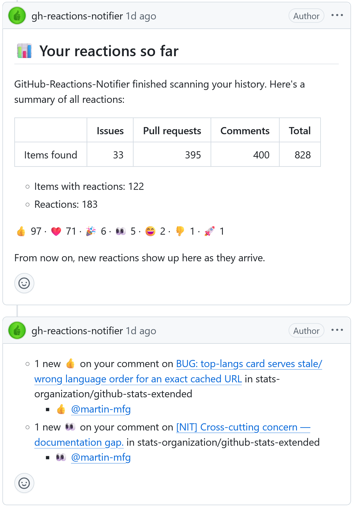

  
  <h1>GitHub Reactions Notifier</h1>
  
Get a GitHub notification for new reactions to your issues, PRs or comments; and a summary of all past ones.

  <picture>
    <source
      srcset="docs/inbox-dark.png"
      media="(prefers-color-scheme: dark)"
    />
    <!-- light mode -->
    
  </picture>

> [!WARNING]
> **This is a prototype (alpha).** It may have bugs or be shut down at any time.
> I'm releasing it early to find out whether people want it.
> [Your feedback](#feedback) decides whether it gets developed further.

GitHub notifies you about comments, mentions and reviews, but never about reactions.
When someone adds 👍, ❤️ or 🎉 to your issue, you only find out by accident. GitHub Reactions Notifier fills this gap. Sign up once, and you get a summary of all reactions you've received so far, plus a GitHub notification for every new one.

**[Sign up here](https://github-reactions-notifier.vercel.app/)**

## How it works

1. **Sign in with GitHub.** The app asks for no permissions beyond your public profile. Signing in proves the account is yours, so nobody else can sign you up, and lets the app read your public activity using your own GitHub rate limit.
2. **The app opens an inbox issue for you** in this repository and mentions you in it.
   That subscribes you to the issue, so GitHub notifies you about every update inside.
3. **It scans your history** and posts a one-time **summary** of the reactions your content
   has received so far: how many items it found, how many reactions they have, and the total
   per emoji.
4. **New reactions are posted as comments** in your inbox, usually within a few minutes.
   Several reactions are bundled into one comment.
   The people named in your inbox are **not** mentioned or notified. Only you are.

## What's included, and what isn't yet

| Included                                      | Not yet included                                                                                         |
| --------------------------------------------- | -------------------------------------------------------------------------------------------------------- |
| Issues you opened                             | Discussions and discussion comments                                                                      |
| Pull requests you opened                      | Pull request reviews and review inline comments                                                          |
| Your comments on issues and pull requests     | Commit comments and releases                                                                             |
| Content in public repositories                | Content in private repositories                                                                          |
| Your content from all time, however old       | Content by others in repositories you own                                                                |
| Notifications a few minutes after a reaction  | Other notification channels like [Atom](<https://en.wikipedia.org/wiki/Atom_(web_standard)>) or Webhooks |
| A one-time summary of your existing reactions | Filters (e.g. only open issues)                                                                          |
|                                               | A notification when a reaction is removed                                                                |

Missing something you need? [Tell me](#feedback).

## Good to know

- **Your inbox is public.** Anyone can see the reactions on your content and who added them.
  Reactions are public on GitHub anyway.
  Content from private repositories never appears there.
- **Reactions from before you signed in are never notified one by one.** They only count
  towards the summary.
- **Your own reactions to your posts are reported too**. This is especially useful for testing.
- **The first scan takes time.** For most accounts it takes a few minutes; for very active
  accounts it can take longer. New reactions are reported while it runs, so you may get
  notifications before the summary arrives.
- **Older content is checked less often.** A reaction on something you posted yesterday shows
  up within minutes. One on something from years ago can take longer. Once an item gets a
  reaction, it is checked often again.
- **The app uses your GitHub API quota.** Every GitHub account can make a limited number of
  API requests per hour, shared by all apps and tools you use. The app stops making requests
  once 80% of your hourly quota is used.

## Only want the summary?

Choose **"Just send me a one-time summary"** on the website instead of "Get notified about
reactions". The app scans your history, posts the summary to your inbox issue, and then stops:
it makes no further requests for you and posts nothing else.

You can switch at any time with the same two buttons:

- **"Just send me a one-time summary"** stops notifications. If you click it
  again after your summary arrived, the app rescans your history and posts a fresh summary.
- **"Get notified about reactions"** turns notifications back on. The app rescans your history
  and posts a fresh summary, then notifies you about new reactions again.

A rescan reads your whole history again, so it takes as long as the first scan and uses your
API quota the same way.

## Known limitations of the prototype

- Data may be reset while the app is in development. You would have to sign in again.
- In rare edge cases, some reactions may not be reported. For example: more than 100 new
  reactions on a single item between two checks.
- If you rename a repository or edit a title, your inbox may keep showing the old name.

## Feedback

This prototype exists to find out whether the app is worth building further.
Please [start a discussion](https://github.com/martin-mfg/github-reactions-notifier/discussions) and
tell me:

- Do you find it useful? Would you keep using it?
- What's missing for you?
- Did anything go wrong?

## Credits

Daumen hoch hand Icon by recognizeapp.com on
<a href="https://icon-icons.com/de/authors/533-recognizeapp-com">Icon-Icons.com</a>
